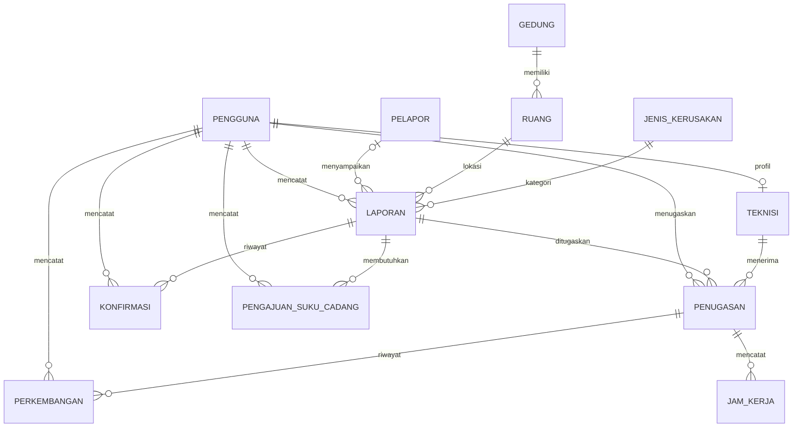

# Database MariaDB Lama — Tidak Dipakai Backend Aktif

> Skema kanonis aplikasi sekarang adalah Prisma + SQLite di `prisma/schema.prisma`, sesuai source backend yang diberikan. Berkas SQL dalam folder ini mendokumentasikan database MariaDB `helpdesk_fasilitas_kampus` yang sudah ada. Database beserta datanya dipertahankan, tetapi backend aplikasi tidak menggunakannya. Jangan jalankan SQL di folder ini untuk menyiapkan backend SQLite.

## Status pemeriksaan

Database MariaDB lokal tetap tersedia sebagai database lama. Source backend dan frontend dari ZIP sekarang berada di root proyek; skema Prisma SQLite adalah sumber kebenaran untuk API aktif. Pemeriksaan ini tidak menghapus atau mengubah isi database MariaDB.

Koneksi Database Client yang tersimpan di VS Code menunjuk ke database lokal `helpdesk_fasilitas_kampus`. Server yang dapat diakses saat pemeriksaan adalah MariaDB 10.4.32. Database sudah berisi 12 tabel, 9 akun, 6 profil teknisi, 8 gedung, 3 ruang contoh, dan 4 jenis kerusakan. Tabel transaksi laporan/penugasan/perkembangan/jam kerja/konfirmasi/pengajuan masih kosong. Skema kolom aktif cocok dengan SQL lokal. Migrasi penghapusan riwayat sudah diterapkan; foreign key terkait kini `RESTRICT`. Nama database yang ada dipertahankan agar tidak membuat sumber data kedua. Backend remote memakai Express + Prisma dengan SQLite lokal (`file:./dev.db`); model Prisma memakai integer IDs dan nama tabel/kolom default berbahasa Inggris. Database MariaDB aktif memakai UUID `CHAR(36)` dan tabel/kolom snake_case berbahasa Indonesia. Jadi backend belum kompatibel dengan MariaDB aktif; mengganti URL/provider saja akan gagal. Pemetaan seluruh model ke struktur ini adalah perubahan kontrak database/backend yang belum dilakukan.

## Dasar analisis dan keputusan

### Kecocokan backend dengan MariaDB aktif

Backend dalam ZIP adalah aplikasi Express + Prisma yang memakai SQLite (`DATABASE_URL=file:./dev.db`). Frontend React/Vite memanggil API backend melalui `VITE_API_BASE_URL`; kontraknya mencakup autentikasi, master data, laporan, penugasan, pekerjaan/jam kerja, konfirmasi, suku cadang, dan manajemen. Endpoint yang dirujuk frontend juga tersedia pada route backend yang disertakan.

Skema Prisma dan MariaDB aktif tidak dapat dipertukarkan hanya dengan mengubah provider/URL. Perbedaannya mencakup integer IDs di backend dibanding UUID `CHAR(36)` di database; tabel akun `User` dibanding `pengguna`; role `PELAPOR` dan relasi akun pelapor yang diperlukan backend tidak tersedia di skema akun aktif; kategori kerusakan backend berisi 12 jenis dan bidang, sementara tabel aktif menyimpan empat kategori umum; nilai status laporan dan penugasan berbeda; backend menautkan `Perkembangan` langsung ke laporan, sedangkan database aktif menautkannya ke penugasan; juga terdapat perbedaan atribut foto, SLA, konfirmasi, dan tindak lanjut suku cadang. `prisma/seed.js` membuat data akun/master dan bukan seeder yang aman untuk langsung dijalankan pada database operasional.

Karena database aktif sudah berisi akun dan master, perubahan provider/mapping/relasi/status serta migrasi datanya perlu disetujui sebagai satu perubahan kontrak. Tidak ada file backend yang disalin atau diubah, tidak ada migrasi Prisma yang dijalankan, dan tidak ada seed backend yang dijalankan terhadap MariaDB aktif.

Arsip proyek berisi SRS, AS-IS dan daftar masalah, desain sistem, pemodelan JSON berisi 43 diagram, PRD, transkrip wawancara, `schema.sql`, dan satu halaman panjang mockup PDF. Mockup dilihat secara visual; rancangan mencakup login, dashboard, tiket, data teknisi, SLA, pengajuan, halaman pelacakan publik, dan antarmuka teknisi mobile.

Kebutuhan yang terkonfirmasi meliputi pencatatan terpusat dari WhatsApp/telepon/kedatangan, gedung dan ruang, kategori listrik/AC/bangunan/air, foto, prioritas dan target, penugasan beberapa teknisi, perkembangan, jam kerja individual, konfirmasi dan buka kembali, penahanan karena suku cadang di atas Rp500.000, serta laporan bulanan dan pemantauan keterlambatan.

| Perbedaan sumber | Keputusan implementasi |
|---|---|
| PRD merekomendasikan PostgreSQL, source API memakai SQLite, dan database lokal lama adalah MariaDB. | Untuk aplikasi aktif, ikuti keputusan backend dan gunakan Prisma + SQLite. MariaDB dan SQL folder ini dipertahankan sebagai arsip/database lama yang tidak dipakai API. |
| Desain fisik ringkas dan ERD UML berbeda pada jumlah/penamaan tabel. PRD yang direvisi dan SQL aktual memakai `pengguna` serta profil `teknisi` terpisah. | Pertahankan dua tabel tersebut karena sesuai database aktif dan kebutuhan akun teknisi 1:1. Total skema aktual 12 tabel. |
| Beberapa gambar/mockup menunjukkan halaman publik dan alur keputusan Keuangan, sedangkan SRS/PRD menyebut akses Pelapor dan keputusan Keuangan belum tervalidasi. | Database menyimpan nomor tiket unik dan catatan pengajuan, tetapi tidak menambah login Pelapor, token publik, atau status persetujuan yang belum menjadi aturan bisnis terkonfirmasi. |
| Wawancara belum menetapkan awal SLA, definisi “1 hari”, hari kalender/kerja untuk konfirmasi, kalender libur, atau perlakuan jeda SLA. | `sla_started_at` dan `sla_deadline_at` tetap nullable. Tidak ada kalkulasi otomatis atau asumsi kalender di database. |
| Nilai resmi nama gedung/ruang belum tersedia. | Nilai `Gedung A`–`Gedung H` dan tiga ruang pada seed adalah data contoh dari rancangan, bukan daftar resmi kampus. Verifikasi sebelum dipakai operasional. |

## Tabel, primary key, dan fungsi

Semua ID memakai `CHAR(36)` UUID. Storage gambar berada di object storage; database hanya menyimpan `foto_key`/`foto_bukti_key`.

| Tabel | Primary key | Fungsi dan kolom penting | Hubungan foreign key |
|---|---|---|---|
| `pengguna` | `id_pengguna` | Akun internal, `nama`, `username` unik, `password_hash`, `role`, `aktif`. | Direferensikan oleh profil teknisi, laporan pencatat, penugasan pencatat, perkembangan, konfirmasi, dan pengajuan. |
| `teknisi` | `id_teknisi` | Profil teknisi, bidang keahlian, status aktif; satu akun hanya satu profil (`id_pengguna` unik). | `id_pengguna` → `pengguna`. |
| `pelapor` | `id_pelapor` | Identitas opsional: nama, kontak, asal kelompok. Bukan akun login. | Direferensikan opsional oleh `laporan`; penghapusan identitas akan menyetel FK laporan menjadi NULL. |
| `gedung` | `id_gedung` | Master gedung; kode gedung unik jika diisi. | Parent bagi `ruang`. |
| `ruang` | `id_ruang` | Nama/nomor ruang di dalam gedung; kombinasi gedung dan nama ruang unik. | `id_gedung` → `gedung`. |
| `jenis_kerusakan` | `id_jenis` | Kategori Listrik, AC, Bangunan, Air; nama unik. | Parent bagi `laporan`. |
| `laporan` | `id_laporan` | Tiket, `nomor_tiket` unik, lokasi, kategori, pencatat, kanal, deskripsi, foto, prioritas, status, serta kolom target/jeda SLA. | `id_pelapor` → `pelapor`; `id_ruang` → `ruang`; `id_jenis` → `jenis_kerusakan`; `dicatat_oleh` → `pengguna`. |
| `penugasan` | `id_penugasan` | Relasi satu laporan ke satu teknisi untuk satu periode penugasan; status individual dan riwayat penugasan ulang. | `id_laporan` → `laporan`; `id_teknisi` → `teknisi`; `ditugaskan_oleh` → `pengguna`. |
| `perkembangan` | `id_perkembangan` | Riwayat status, hasil pemeriksaan, tindakan, catatan, foto bukti, pencatat, waktu. | `id_penugasan` → `penugasan`; `dicatat_oleh` → `pengguna`. |
| `jam_kerja` | `id_jam_kerja` | Tanggal, total jam positif, dan catatan untuk teknisi pada penugasan tersebut. | `id_penugasan` → `penugasan` (yang menentukan teknisi dan laporan). |
| `konfirmasi` | `id_konfirmasi` | Riwayat konfirmasi `SELESAI`, `BELUM_SELESAI`, atau `TIDAK_ADA_TANGGAPAN`, kanal dan catatan. Relasi laporan 1:M agar siklus buka kembali tetap tercatat. | `id_laporan` → `laporan`; `dicatat_oleh` → `pengguna`. |
| `pengajuan_suku_cadang` | `id_pengajuan` | Kebutuhan, nilai, status tindak lanjut awal, pencatat, tanggal dan catatan. | `id_laporan` → `laporan`; `dicatat_oleh` → `pengguna`. |

### ERD skema aktif



## Aturan integritas dan batas database

- InnoDB, PK UUID, FK dengan aturan hapus yang membatasi kehilangan riwayat, username dan tiket unik, serta ruang unik per gedung.
- `total_jam > 0`; nilai pengajuan suku cadang `> 500000`. Ambang dan basis perhitungan mengikuti aturan wawancara/PRD; backend tetap perlu memberi pesan validasi.
- Prioritas laporan: `DARURAT`, `TINGGI`, `NORMAL`. Status laporan: `DITERIMA`, `DITUGASKAN`, `DALAM_PENANGANAN`, `DITAHAN`, `MENUNGGU_KONFIRMASI`, `DIBUKA_KEMBALI`, `SELESAI`.
- Satu laporan dapat memiliki beberapa teknisi. Batas dua/tiga teknisi dan syarat “semua penugasan selesai sebelum menunggu konfirmasi” adalah aturan transaksi/backend, bukan constraint sederhana.
- Foto awal nullable secara teknis karena kebijakan pengecualian laporan tanpa foto belum diklarifikasi, meskipun foto disebut sebagai informasi minimum.
- `status_pengajuan` tetap fleksibel; prosedur persetujuan/penolakan Keuangan belum dijelaskan. Skema tidak mengasumsikan keputusan.
- Database menyediakan `is_paused`, `waktu_mulai_pause`, dan `total_pause_menit`, tetapi tidak mengimplementasikan algoritma jeda. Aturan jeda masih perlu disepakati.
- Status keterlambatan adalah hasil perhitungan terhadap deadline yang valid, bukan nilai status permanen. Jangan menghitung deadline sampai aturan waktu awal, hari kerja, kalender libur, dan “1 hari” disepakati.
- Jangan hapus permanen laporan/penugasan melalui alur normal. Constraint RESTRICT melindungi catatan historis; aplikasi sebaiknya menutup/mengubah status.

## Cara menyiapkan database

Target lokal yang terverifikasi: MariaDB 10.4.32 melalui XAMPP, nama database `helpdesk_fasilitas_kampus`. Pastikan service MySQL/MariaDB berjalan, lalu dari root repository jalankan di Command Prompt:

```bat
C:\xampp\mysql\bin\mysql.exe -u root -p < database\schema.sql
C:\xampp\mysql\bin\mysql.exe -u root -p helpdesk_fasilitas_kampus < database\seed.sql
```

Masukkan password pada prompt client. Jangan menaruh password di command, file SQL, atau Git. Jika akun lokal tidak memakai password, sesuaikan opsi `-p` dengan konfigurasi lokal. Di PowerShell, cara interaktif yang setara adalah membuka `mysql.exe -u root -p`, lalu menjalankan `SOURCE C:/Users/HP/OneDrive/Dokumen/SAD-FINAL/Helpdesk-fasilitas-kampus/database/schema.sql;` dan `SOURCE C:/Users/HP/OneDrive/Dokumen/SAD-FINAL/Helpdesk-fasilitas-kampus/database/seed.sql;`.

`schema.sql` memakai `CREATE DATABASE IF NOT EXISTS` dan `CREATE TABLE IF NOT EXISTS`; tidak ada `DROP`, `TRUNCATE`, atau perubahan definisi tabel yang sudah ada. Karena itu, skrip ini aman untuk bootstrap dan rerun, tetapi **bukan migrasi**: jika suatu tabel lama memiliki kolom berbeda, skrip tidak akan memperbaikinya. Bandingkan `SHOW CREATE TABLE` dan buat migrasi yang ditinjau sebelum perubahan struktural.

Untuk mempertahankan riwayat saat penghapusan, `schema.sql` baru memakai `ON DELETE RESTRICT` pada relasi laporan/penugasan ke riwayat turunannya. Database yang sudah dibuat dengan versi lama memiliki `ON DELETE CASCADE`; setelah memeriksa nama constraint dan jumlah baris, migrasi satu kali `migration_preserve_history.sql` mengganti rule tersebut tanpa menghapus atau mengubah baris. Migrasi ini mengubah struktur dan bukan idempotent: jalankan hanya sekali pada database yang sudah diverifikasi.

`seed.sql` memakai `INSERT ... ON DUPLICATE KEY UPDATE` dengan operasi tanpa perubahan nilai. Data master, akun demo dan profil teknisi tidak dihapus atau ditimpa saat seeder dijalankan ulang; konflik ID/natural key tidak mengubah baris yang sudah ada. Akun disimpan sebagai bcrypt hash, bukan plaintext. Kredensial login tidak didokumentasikan di sini. Pada database yang sudah berisi akun, seeder mempertahankan hash/kondisi akun yang ada.

Untuk database yang dibuat dengan versi lama dan masih memakai `ON DELETE CASCADE`, periksa dahulu `SHOW CREATE TABLE` agar nama constraint cocok, pastikan database target benar, lalu jalankan migrasi satu kali dari Command Prompt:

```bat
C:\xampp\mysql\bin\mysql.exe -u root -p helpdesk_fasilitas_kampus < database\migration_preserve_history.sql
```

Migrasi ini khusus upgrade database lama. Jangan jalankan pada instalasi baru karena `schema.sql` sudah membuat rule `RESTRICT`; jangan jalankan ulang setelah migrasi berhasil.

### Konfigurasi backend

Backend aktif memakai `DATABASE_URL` Prisma dan SQLite (`file:./dev.db`). Ikuti bagian menyiapkan backend di README root. SQL dalam folder `database/` hanya untuk MariaDB lama dan tidak boleh dipakai sebagai skema aplikasi aktif. Kredensial seed dan JWT disimpan di `.env` yang tidak di-commit.

## Verifikasi yang dapat dijalankan

Koneksi dan struktur dapat diperiksa dengan:

```sql
SELECT VERSION();
SHOW TABLES FROM helpdesk_fasilitas_kampus;
SHOW CREATE TABLE helpdesk_fasilitas_kampus.laporan;
SELECT COUNT(*) FROM helpdesk_fasilitas_kampus.pengguna;
SELECT COUNT(*) FROM helpdesk_fasilitas_kampus.teknisi;
```

Tes API memakai database SQLite khusus `prisma/test.db` yang dihapus dan dibuat ulang oleh test harness; reset hanya menyentuh file tes itu. Tes SQL MariaDB yang dicatat di bawah dilakukan terpisah pada transaksi yang di-rollback. Database MariaDB aktif tidak digunakan oleh backend maupun tes API.

## Keterlacakan kebutuhan

| Sumber kebutuhan | Tabel/kolom pendukung | Fitur/backend yang diperlukan |
|---|---|---|
| Wawancara: laporan tersebar, dicatat di buku, sulit dilacak; REQ-01–03 | `laporan`, `pelapor`, `ruang`, `gedung`, `jenis_kerusakan`; kanal, foto, deskripsi, pencatat | Form intake Admin, daftar/detail dan pencarian tiket. Endpoint aktual belum ada di repository. |
| REQ-04–05, BR-04–08: prioritas dan target penanganan | `laporan.prioritas`, `target_sla`, `sla_started_at`, `sla_deadline_at` | Validasi prioritas/label target. Mesin SLA menunggu aturan awal kalender yang belum dikonfirmasi. |
| Wawancara multi-teknisi; REQ-06–08, BR-09 | `pengguna`, `teknisi`, `penugasan` | Pemilihan teknisi sesuai bidang, daftar tugas, batas tim dan agregasi status di backend. |
| REQ-09–10: progres, hasil pemeriksaan, tindakan dan foto bukti | `perkembangan`, `penugasan`, `laporan` | Update mobile dan pencatatan histori, tanpa menimpa catatan terdahulu. |
| Wawancara penilaian jam tiap teknisi; REQ-11, REQ-18, BR-10/17 | `jam_kerja` → `penugasan` → `teknisi` | Input total jam dan laporan rekap per teknisi/per pekerjaan. |
| BR-12–14; REQ-12–14: konfirmasi, buka kembali, tidak ada tanggapan | `konfirmasi`, `laporan`, `penugasan` | Admin mencatat tanggapan dan membuka penugasan ulang. Auto-close menunggu definisi tiga hari dan awal hitung. |
| REQ-15–16, BR-15: pekerjaan aktif dan SLA terlambat | `laporan.status`, `sla_deadline_at`, `penugasan` | Dashboard Kepala Unit dan scheduler/alert hanya jika deadline dapat dihitung; belum ada worker/API. |
| REQ-17, BR-16: laporan bulanan per gedung dan kategori | `laporan.tanggal_lapor`, `ruang`, `gedung`, `jenis_kerusakan` | Query rekap bulanan oleh backend. |
| BR-11, REQ-19–20: suku cadang dan pekerjaan ditahan | `pengajuan_suku_cadang`, `laporan.is_paused`, kolom pause | Pencatatan pengajuan dan status menunggu. Proses approve/reject tidak ditetapkan. |
| NFR-04–06, NFR-12: akun internal, peran, kerahasiaan | `pengguna.role`, `password_hash`, `aktif` | Hashing, autentikasi, RBAC dan proteksi API harus ada di backend; tidak tersedia pada branch ini. |

### Pertanyaan kebijakan yang masih terbuka

Awal hitung SLA; arti satu hari untuk prioritas Tinggi; kalender kerja/libur untuk Normal; apakah SLA berhenti saat ditahan; apakah tiga hari konfirmasi adalah hari kalender/kerja dan mulai dari waktu mana; aturan laporan tanpa foto; daftar resmi gedung/ruang; identitas Pelapor wajib atau opsional; hasil dan status proses Keuangan; serta perlu tidaknya portal publik/akun Keuangan.
